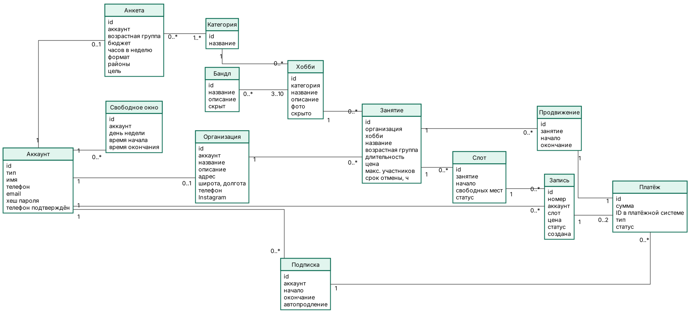

# 2. Техническое задание (Спецификация требований к ПО) — Hobbyo

**Версия:** 1.1 · **Команда:** FIP 13 (SEST, TSI AUCA)

## 1. Введение

### 1.1. Назначение документа
Документ описывает требования к системе Hobbyo: классы пользователей, функциональные требования с приоритетами, требования к качеству, ограничения, модель данных, этапы разработки и критерии приёмки. Документ является основой для проектирования, разработки и приёмки MVP.

### 1.2. Глоссарий

| Термин | Определение |
|---|---|
| Хобби | Направление досуга (например, гончарное ремесло, скалолазание, чир-спорт) |
| Категория | Группа хобби (творчество, спорт, музыка, игры и т. д.) |
| Организация | Студия, секция или клуб, проводящий занятия по хобби |
| Занятие | Описание того, что проводит организация: хобби, цена, длительность, число мест |
| Слот | Конкретная дата и время проведения занятия |
| Пробное занятие | Разовое посещение слота новичком с оплатой за одно посещение |
| Бандл | Подборка из 3–10 хобби одной тематики (например, «Творческий бандл») |
| Анкета интересов | Опрос при регистрации из 7 вопросов для персонализации рекомендаций |
| Свободное окно | Промежуток времени в неделе, отмеченный пользователем как доступный для занятий |
| Запись | Бронирование пользователем места в слоте |
| Процент совпадения | Число от 0 до 100, показывающее соответствие хобби ответам анкеты |
| Продвижение | Платное размещение занятия организации выше остальных в рекомендациях и поиске |
| Подписка Pro | Платная подписка пользователя с дополнительными возможностями |
| MoSCoW | Метод приоритизации: Must (обязательно), Should (желательно), Could (можно), Won't (не в этой версии) |

## 2. Классы пользователей

| Роль | Описание |
|---|---|
| Гость | Незарегистрированный посетитель. Просматривает каталог хобби и бандлы, регистрируется |
| Пользователь | Зарегистрированный человек 14+ лет. Проходит анкету, получает рекомендации, задаёт личный график, записывается на пробные занятия |
| Организация | Представитель студии, секции или клуба. Ведёт профиль, публикует занятия и расписание, видит записавшихся |
| Администратор | Сотрудник платформы Hobbyo. Ведёт каталог хобби и бандлы |

**Смежные системы:** SMS-шлюз, почтовый сервер (SMTP), платёжная система (MBank, Элсом, O!Деньги), 2ГИС API, Google Calendar. См. [контекстную диаграмму](03_context_diagram.md).

### 2.1. Предположения о пользователях
- **ПП-1.** Пользователи читают и пишут на русском языке.
- **ПП-2.** Пользователи владеют базовыми навыками работы со смартфоном (браузер, получение SMS и email).
- **ПП-3.** Пользователю 14 лет или больше.
- **ПП-4.** Представитель организации владеет базовыми навыками работы с ПК или смартфоном.

## 3. Функциональные требования

Название требования: `Роль.Объект.Действие`. Приоритет — по MoSCoW (раздел 4): **M** — Must, **S** — Should, **C** — Could.

### 3.1. Гость

| ID | Требование | Определение | Пр. |
|---|---|---|---|
| ФТ-1 | Гость.Каталог хобби.Просмотр | Система должна позволять пользователю с ролью «Гость» просматривать каталог хобби с фильтром по категории и поиском по названию. Атрибуты хобби: название, категория, описание, фото, минимальная и максимальная цена пробного занятия, число организаций | M |
| ФТ-2 | Гость.Бандл.Просмотр | Система должна позволять пользователю с ролью «Гость» просматривать бандлы: название, описание, список входящих хобби | S |
| ФТ-3 | Гость.Аккаунт.Регистрация | Система должна позволять пользователю с ролью «Гость» зарегистрироваться, указав: тип аккаунта (Пользователь / Организация), имя, номер телефона, email, пароль. Номер телефона подтверждается кодом из SMS | M |
| ФТ-4 | Гость.Аккаунт.Вход | Система должна позволять пользователю с ролью «Гость» войти по номеру телефона и паролю | M |

### 3.2. Пользователь

| ID | Требование | Определение | Пр. |
|---|---|---|---|
| ФТ-10 | Пользователь.Анкета интересов.Заполнение | Система должна позволять пользователю с ролью «Пользователь» заполнить анкету из 7 вопросов: возрастная группа; интересующие категории (одна или несколько); бюджет на одно занятие; сколько часов в неделю готов уделять; формат (один / с друзьями / неважно); предпочитаемые районы Бишкека; цель (попробовать новое / найти постоянное хобби) | M |
| ФТ-11 | Пользователь.Анкета интересов.Изменение | Система должна позволять пользователю с ролью «Пользователь» изменить ответы анкеты. После сохранения рекомендации пересчитываются | M |
| ФТ-12 | Пользователь.Рекомендации.Просмотр | Система должна показывать пользователю с ролью «Пользователь» не более 20 рекомендованных хобби с процентом совпадения, отсортированных по убыванию процента. При равном проценте выше показывается хобби с большим числом организаций | M |
| ФТ-13 | Пользователь.Личный график.Задание | Система должна позволять пользователю с ролью «Пользователь» добавлять, изменять и удалять свободные окна: день недели, время начала, время окончания. Окна одного дня не пересекаются | M |
| ФТ-14 | Пользователь.Подходящие слоты.Просмотр | Система должна показывать пользователю с ролью «Пользователь» слоты выбранного хобби на ближайшие 14 дней, которые целиком попадают в его свободные окна и имеют хотя бы одно свободное место. Атрибуты: организация, адрес, дата и время, цена, число свободных мест | M |
| ФТ-15 | Пользователь.Запись.Создание | Система должна позволять пользователю с ролью «Пользователь» записаться на слот. Запись сразу получает статус «Подтверждена», число свободных мест слота уменьшается на 1. Система не допускает две записи одного пользователя, пересекающиеся по времени. Если онлайн-оплата (ФТ-20) не реализована, оплата производится на месте | M |
| ФТ-16 | Пользователь.Запись.Отмена | Система должна позволять пользователю с ролью «Пользователь» отменить запись не позднее срока отмены, установленного организацией (по умолчанию за 12 часов до начала). Статус записи меняется на «Отменена пользователем», место освобождается | M |
| ФТ-17 | Пользователь.Мои записи.Просмотр | Система должна позволять пользователю с ролью «Пользователь» просматривать свои записи с фильтром по статусу: предстоящие, прошедшие, отменённые | M |
| ФТ-18 | Пользователь.Напоминание.Получение | Система должна отправлять пользователю с ролью «Пользователь» напоминание о записи по email за 24 часа и за 2 часа до начала занятия | M |
| ФТ-19 | Пользователь.Бандл.Выбор | Система должна позволять пользователю с ролью «Пользователь» выбрать бандл и отметить в нём от 1 до 3 хобби для пробных занятий. Отмеченные хобби выводятся первыми в рекомендациях | S |
| ФТ-20 | Пользователь.Запись.Оплата онлайн | Система должна позволять пользователю с ролью «Пользователь» оплатить запись через платёжную систему при её создании. Оплата производится за одно занятие. Запись создаётся только после успешной оплаты | S |
| ФТ-21 | Пользователь.Оплата.Возврат | Система должна возвращать пользователю с ролью «Пользователь» полную сумму онлайн-оплаты при отмене записи в срок (ФТ-16) или при отмене слота организацией (ФТ-45) | S |
| ФТ-22 | Пользователь.Организации.Поиск на карте | Система должна позволять пользователю с ролью «Пользователь» искать организации по хобби в радиусе 1, 3 или 5 км от выбранной точки на карте | S |
| ФТ-23 | Пользователь.Запись.Экспорт в календарь | Система должна позволять пользователю с ролью «Пользователь» добавить запись в Google Calendar или скачать её файлом .ics | S |
| ФТ-24 | Пользователь.Подписка Pro.Оформление | Система должна позволять пользователю с ролью «Пользователь» оформить и отменить подписку Pro сроком на 1 месяц с автопродлением, с оплатой через платёжную систему. Состав преимуществ Pro и цена определяются в разделе 10 «Бизнес-модель» | C |

### 3.3. Организация

| ID | Требование | Определение | Пр. |
|---|---|---|---|
| ФТ-40 | Организация.Профиль.Создание | Система должна позволять пользователю с ролью «Организация» создать профиль: название, категория, описание, адрес, телефон, ссылка на Instagram, до 10 фото. Профиль становится видимым в каталоге сразу после сохранения | M |
| ФТ-41 | Организация.Профиль.Редактирование | Система должна позволять пользователю с ролью «Организация» изменять атрибуты своего профиля из ФТ-40 | M |
| ФТ-42 | Организация.Занятие.Создание | Система должна позволять пользователю с ролью «Организация» создать занятие: хобби из каталога, название, описание, возрастная группа, длительность в минутах, цена пробного занятия в сомах, максимальное число участников, срок бесплатной отмены в часах | M |
| ФТ-43 | Организация.Занятие.Редактирование | Система должна позволять пользователю с ролью «Организация» изменять атрибуты занятия из ФТ-42. Изменение цены не влияет на уже созданные записи | M |
| ФТ-44 | Организация.Слот.Публикация | Система должна позволять пользователю с ролью «Организация» публиковать слоты занятия: дата и время начала, разовый или еженедельный на срок до 8 недель. Слоты одного занятия не пересекаются по времени | M |
| ФТ-45 | Организация.Слот.Отмена | Система должна позволять пользователю с ролью «Организация» отменить слот. Все записи слота получают статус «Отменена организацией», записанным отправляется email | M |
| ФТ-46 | Организация.Участники слота.Просмотр | Система должна позволять пользователю с ролью «Организация» просматривать по каждому слоту список записавшихся: имя, телефон, статус записи | M |
| ФТ-47 | Организация.Продвижение.Покупка | Система должна позволять пользователю с ролью «Организация» оплатить продвижение занятия на 7 или 30 дней. Продвигаемое занятие показывается в рекомендациях и поиске выше остальных с пометкой «Реклама». Цена определяется в разделе 10 | C |

### 3.4. Администратор

| ID | Требование | Определение | Пр. |
|---|---|---|---|
| ФТ-60 | Администратор.Хобби.Управление | Система должна позволять пользователю с ролью «Администратор» создавать, изменять и скрывать хобби и категории каталога | M |
| ФТ-61 | Администратор.Бандл.Управление | Система должна позволять пользователю с ролью «Администратор» создавать, изменять и скрывать бандлы: название, описание, от 3 до 10 хобби | S |

### 3.5. Интеграции

| ID | Требование | Определение | Пр. |
|---|---|---|---|
| ФТ-80 | Система.SMS.Отправка кода | Система должна отправлять через SMS-шлюз 6-значный код подтверждения, действующий 5 минут | M |
| ФТ-81 | Система.Email.Отправка | Система должна отправлять email-уведомления (ФТ-18, ФТ-45) через почтовый сервер SMTP | M |
| ФТ-82 | Система.Платёж.Проведение | Система должна передавать платёжной системе сумму и номер записи и получать статус платежа (успешно / отклонено) | S |
| ФТ-83 | Система.Платёж.Возврат | Система должна инициировать возврат в платёжной системе в случаях из ФТ-21 | S |
| ФТ-84 | Система.Адрес.Геокодирование | Система должна получать координаты адреса организации через 2ГИС API при создании и изменении профиля | S |

## 4. Приоритеты (MoSCoW)

| Приоритет | Что входит | Требования |
|---|---|---|
| **Must** — без этого MVP не работает | Регистрация и вход по SMS, каталог хобби, анкета интересов, рекомендации, личный график, подбор слотов под график, запись и отмена записи, мои записи, напоминания, профиль организации, занятия и расписание, участники слота, управление каталогом | ФТ-1, 3, 4, 10–18, 40–46, 60, 80, 81 |
| **Should** — важно, но MVP запускается без этого | Бандлы хобби, онлайн-оплата и возвраты, поиск на карте, экспорт в Google Calendar | ФТ-2, 19–23, 61, 82–84 |
| **Could** — после финансовой модели | Подписка Pro, платное продвижение организаций | ФТ-24, 47 |
| **Won't** — не входит в эту версию | Приглашение друга, профили детей, отзывы и рейтинг, чат с организацией, лента мероприятий, отметка посещений, отчёты организации и платформы, модерация и блокировки, верификация организаций, push-уведомления, кыргызский язык, маскот и стрики | — |

## 5. Требования к качеству в использовании (Quality in Use)

Терминология — ГОСТ Р ИСО 9241-210-2012.

- **КИ-1. Результативность.** Доля успешных завершений сценария «Записаться на пробное занятие» необученным пользователем — не менее 80%.
- **КИ-2. Скорость обучения.** Новый пользователь должен выполнить первую запись без инструкции не более чем за 10 минут с момента регистрации.
- **КИ-3. Эффективность.** Время выполнения сценариев обученным пользователем в 80% случаев: запись на занятие — не более 3 мин; заполнение анкеты — не более 2 мин; публикация слота организацией — не более 2 мин.
- **КИ-4. Точность.** Доля ошибок обученного пользователя в первые 5 минут сеанса — не более 5%.
- **КИ-5. Удовлетворённость.** Средняя оценка в опросе после первой записи — не ниже 4 из 5.

## 6. Ограничения

### 6.1. Операционная среда
- **ОС-1.** Веб-приложение должно работать в браузерах Google Chrome 120+, Safari 16+, Firefox 115+, Samsung Internet 23+.
- **ОС-2.** Веб-приложение должно корректно отображаться на экранах шириной от 360 до 1920 пикселей.
- **ОС-3.** Язык интерфейса — русский.

### 6.2. Ограничения проектирования и реализации
- **ОП-1.** Серверная часть разрабатывается на Python 3.12 и Django 5.
- **ОП-2.** Для хранения данных используется СУБД PostgreSQL 16.
- **ОП-3.** Исходный код хранится в репозитории GitHub, разработка ведётся через pull request.
- **ОП-4.** Система взаимодействует со смежными системами из раздела 3.5.
- **ОП-5.** Обработка персональных данных соответствует Закону КР «Об информации персонального характера».

### 6.3. Предположения об оборудовании
- **ПО-1.** Смартфон пользователя: Android 10+ или iOS 15+, не менее 2 ГБ оперативной памяти.
- **ПО-2.** Сервер: виртуальная машина не менее 2 vCPU, 4 ГБ RAM, 50 ГБ SSD.

### 6.4. Предположения о сетевом соединении
- **СС-1.** У пользователя есть мобильный интернет 3G и выше или Wi-Fi со скоростью не менее 1 Мбит/с.
- **СС-2.** Доступность смежных систем — не менее 99%.

## 7. Требования к внешнему качеству ПО

Терминология — ГОСТ Р ИСО/МЭК 25010-2015.

- **ВК-1. Производительность.** Система должна поддерживать одновременную работу не менее 200 пользователей. 80% запросов выполняются не более чем за 1 с, 95% — не более чем за 3 с.
- **ВК-2. Масштабируемость.** Увеличение производительности в 10 раз должно достигаться добавлением серверных ресурсов без изменения кода.
- **ВК-3. Надёжность.** Система должна восстанавливаться после сбоя не более чем за 15 минут. Резервная копия базы данных создаётся ежедневно и хранится 30 дней.
- **ВК-4. Доступность.** Коэффициент доступности — не менее 99% в месяц, без учёта плановых работ, о которых пользователи предупреждены за 24 часа.
- **ВК-5. Безопасность.** Пароли хранятся в виде хеша (PBKDF2 или Argon2). Всё взаимодействие идёт по HTTPS. Данные банковских карт не хранятся в системе. После 5 неудачных попыток входа вход блокируется на 15 минут.
- **ВК-6. Сопровождаемость.** Покрытие серверного кода автотестами — не менее 60%.

## 8. Требования к составу поставки

- **СП-1.** Поставка включает: исходный код в репозитории GitHub; инструкцию по развёртыванию; комплект документации.

### 8.1. Документация
- **Д-1.** Руководство администратора по развёртыванию и обновлению системы.
- **Д-2.** Руководство пользователя (для ролей Пользователь и Организация).
- **Д-3.** Описание архитектуры системы.
- **Д-4.** Описание API для интеграций.

### 8.2. Лицензирование
- **ЛПЧ-1.** Все права на исходный код принадлежат команде FIP 13.
- **ЛПЧ-2.** Допускается использование компонентов с открытыми лицензиями MIT, BSD, Apache 2.0.
- **ЛПЧ-3.** Запрещено использование нелицензионных и платных сторонних компонентов без согласования с командой.

## 9. Модель данных

Исходник: [`diagrams/data_model.puml`](../diagrams/data_model.puml)

| Сущность | Основные атрибуты | Связи |
|---|---|---|
| Аккаунт | id, тип (пользователь / организация / администратор), имя, телефон, email, хеш пароля, телефон подтверждён | 1 : 1 с Анкетой или Организацией |
| Анкета | id, аккаунт, возрастная группа, бюджет, часов в неделю, формат, районы (список), цель | М : М с Категорией |
| Свободное окно | id, аккаунт, день недели, время начала, время окончания | М : 1 с Аккаунтом |
| Категория | id, название | 1 : М с Хобби |
| Хобби | id, категория, название, описание, фото, скрыто | М : М с Бандлом |
| Бандл | id, название, описание, скрыт | М : М с Хобби |
| Организация | id, аккаунт, название, категория, описание, адрес, широта, долгота, телефон, Instagram | 1 : М с Занятием |
| Занятие | id, организация, хобби, название, возрастная группа, длительность, цена, макс. участников, срок отмены (ч) | 1 : М со Слотом |
| Слот | id, занятие, дата и время начала, свободных мест, статус (активен / отменён) | 1 : М с Записью |
| Запись | id, номер, аккаунт, слот, цена, статус (подтверждена / отменена пользователем / отменена организацией / завершена), создана | 0..1 : 1 с Платежом |
| Платёж | id, запись или подписка или продвижение, сумма, ID в платёжной системе, статус, тип (оплата / возврат) | — |
| Подписка | id, аккаунт, начало, окончание, автопродление | 1 : М с Платежом |
| Продвижение | id, занятие, начало, окончание | 1 : 1 с Платежом |

## 10. Бизнес-модель

> **Раздел в ожидании.** Финансовая аналитика команды пока не готова. Раздел будет заполнен после расчётов в рамках курсов EHI / SFHT. От этого раздела зависят требования ФТ-24 (подписка Pro) и ФТ-47 (продвижение организаций).

| Параметр | Значение |
|---|---|
| Комиссия платформы с одной записи | _ожидает финмодели_ |
| Цена подписки Pro в месяц | _ожидает финмодели_ |
| Состав преимуществ подписки Pro | _ожидает финмодели_ |
| Цена продвижения на 7 дней | _ожидает финмодели_ |
| Цена продвижения на 30 дней | _ожидает финмодели_ |
| Точка безубыточности | _ожидает финмодели_ |

## 11. Этапы разработки

Длительность этапов — оценка команды, уточняется при планировании спринтов.

| Этап | Содержание | Результат | Длительность |
|---|---|---|---|
| 0. Анализ | CustDev с пользователями и организациями, карточка проекта, ТЗ, диаграммы, use cases | Утверждённое ТЗ | Выполнено |
| 1. Проектирование | Архитектура, модель данных, макеты экранов, настройка репозитория и CI | Макеты и каркас проекта | 2 недели |
| 2. MVP | Все требования Must | Работающая система на тестовом сервере | 8 недель |
| 3. Пилот | Подключение 5–15 организаций Бишкека, первые пользователи, сбор отзывов | Отчёт пилота, список доработок | 4 недели |
| 4. Версия 1.0 | Требования Should, исправления по итогам пилота | Публичный запуск | 6 недель |
| 5. Монетизация | Требования Could после готовности бизнес-модели | Платные функции | 4 недели |

## 12. Критерии приёмки

Система принимается, если выполнены все требования Must и пройдены приёмочные проверки ниже. Каждая проверка проводится на тестовом сервере с тестовыми данными.

| ID | Проверка | Связанные ФТ | Ожидаемый результат |
|---|---|---|---|
| КП-1 | Регистрация с неверным SMS-кодом, затем с верным | ФТ-3, 80 | С неверным кодом аккаунт не создаётся, с верным — создаётся |
| КП-2 | Пользователь проходит анкету, выбрав только категорию «Творчество» | ФТ-10, 12 | В рекомендациях не более 20 хобби, первые — из категории «Творчество», проценты идут по убыванию |
| КП-3 | Пользователь задаёт окно Пн 18:00–21:00 и ищет слоты хобби, у которого есть слоты Пн 19:00 и Вт 19:00 | ФТ-13, 14 | Показан только слот Пн 19:00 |
| КП-4 | Два пользователя записываются на последнее место в слоте | ФТ-15 | Первая запись создана, вторая отклонена с сообщением об отсутствии мест |
| КП-5 | Пользователь пытается записаться на два слота в одно время | ФТ-15 | Вторая запись отклонена с сообщением о пересечении |
| КП-6 | Отмена записи за 24 часа и за 1 час до начала при сроке отмены 12 часов | ФТ-16 | Первая отмена выполнена, место освобождено; вторая отклонена |
| КП-7 | Создание записи на слот через 25 часов | ФТ-18, 81 | Email-напоминания приходят за 24 и за 2 часа до начала |
| КП-8 | Организация публикует еженедельный слот на 4 недели | ФТ-44 | Создано 4 слота; слот, пересекающийся с существующим, не создаётся |
| КП-9 | Организация отменяет слот с двумя записями | ФТ-45 | Обе записи в статусе «Отменена организацией», оба пользователя получили email |
| КП-10 | Организация открывает участников слота | ФТ-46 | Видны имена и телефоны записавшихся |
| КП-11 | Администратор скрывает хобби | ФТ-60 | Хобби пропадает из каталога и рекомендаций |
| КП-12 | Нагрузочный тест: 200 одновременных пользователей | ВК-1 | 80% запросов не дольше 1 с, 95% — не дольше 3 с |
| КП-13 | Юзабилити-тест с 5 новыми пользователями | КИ-1, КИ-2 | Не менее 4 из 5 записываются на занятие без подсказок не дольше 10 минут |
