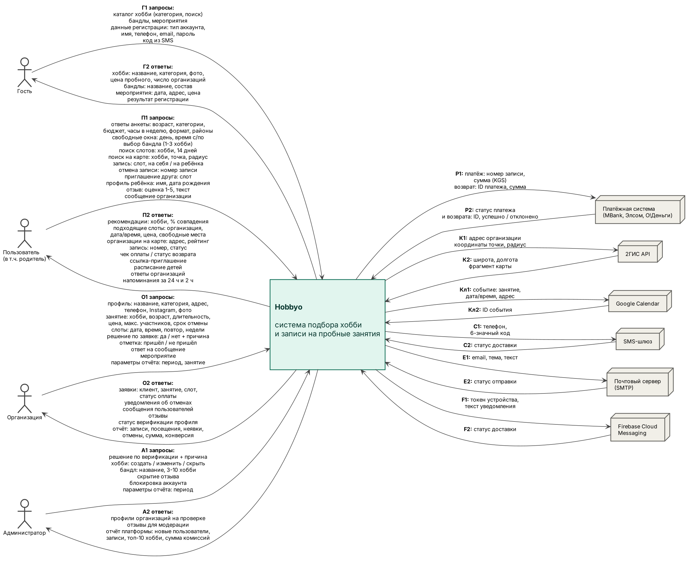

# 3. Контекстная диаграмма — Hobbyo

Исходник: [`diagrams/context.puml`](../diagrams/context.puml) — открыть и отредактировать можно на [plantuml.com](https://plantuml.com/).

Каждая стрелка подписана кодом потока: **1** — запрос / данные в систему, **2** — ответ / данные из системы.

## Потоки данных ролей

| Код | Откуда → Куда | Данные |
|---|---|---|
| Г1 | Гость → Hobbyo | Запрос каталога хобби (категория, поиск); запрос бандлов и мероприятий; данные регистрации: тип аккаунта, имя, телефон, email, пароль; код из SMS |
| Г2 | Hobbyo → Гость | Хобби: название, категория, фото, цена пробного, число организаций; бандлы: название, состав; мероприятия: дата, адрес, цена; результат регистрации |
| П1 | Пользователь → Hobbyo | Ответы анкеты: возраст, категории, бюджет, часы в неделю, формат, районы; свободные окна: день, время с/по; выбор бандла (1–3 хобби); поиск слотов: хобби, 14 дней; поиск на карте: хобби, точка, радиус; запись: слот, на себя или на ребёнка; отмена записи: номер записи; приглашение друга: слот; профиль ребёнка: имя, дата рождения; отзыв: оценка 1–5, текст; сообщение организации |
| П2 | Hobbyo → Пользователь | Рекомендации: хобби, % совпадения; подходящие слоты: организация, дата/время, цена, свободные места; организации на карте: адрес, рейтинг; запись: номер, статус; чек оплаты или статус возврата; ссылка-приглашение; расписание детей; ответы организаций; напоминания за 24 ч и 2 ч |
| О1 | Организация → Hobbyo | Профиль: название, категория, адрес, телефон, Instagram, фото; занятие: хобби, возраст, длительность, цена, макс. участников, срок отмены; слоты: дата, время, повтор, недели; решение по заявке: подтвердить / отклонить + причина; отметка посещения: пришёл / не пришёл; ответ на сообщение; мероприятие; параметры отчёта: период, занятие |
| О2 | Hobbyo → Организация | Заявки: клиент, занятие, слот, статус оплаты; уведомления об отменах; сообщения пользователей; отзывы; статус верификации профиля; отчёт: записи, посещения, неявки, отмены, сумма, конверсия |
| А1 | Администратор → Hobbyo | Решение по верификации + причина; хобби: создать / изменить / скрыть; бандл: название, 3–10 хобби; скрытие отзыва; блокировка аккаунта; параметры отчёта: период |
| А2 | Hobbyo → Администратор | Профили организаций на проверке; отзывы для модерации; отчёт платформы: новые пользователи, записи, топ-10 хобби, сумма комиссий |

## Потоки данных смежных систем

| Код | Откуда → Куда | Данные |
|---|---|---|
| Р1 | Hobbyo → Платёжная система | Платёж: номер записи, сумма (KGS); возврат: ID платежа, сумма |
| Р2 | Платёжная система → Hobbyo | Статус платежа и возврата: ID, успешно / отклонено |
| К1 | Hobbyo → 2ГИС API | Адрес организации; координаты точки и радиус поиска |
| К2 | 2ГИС API → Hobbyo | Широта и долгота; фрагмент карты |
| Кл1 | Hobbyo → Google Calendar | Событие: занятие, дата/время, адрес |
| Кл2 | Google Calendar → Hobbyo | ID созданного события |
| С1 | Hobbyo → SMS-шлюз | Номер телефона, 6-значный код |
| С2 | SMS-шлюз → Hobbyo | Статус доставки |
| E1 | Hobbyo → Почтовый сервер | Email, тема, текст письма |
| E2 | Почтовый сервер → Hobbyo | Статус отправки |
| F1 | Hobbyo → Firebase Cloud Messaging | Токен устройства, текст уведомления |
| F2 | Firebase Cloud Messaging → Hobbyo | Статус доставки |
