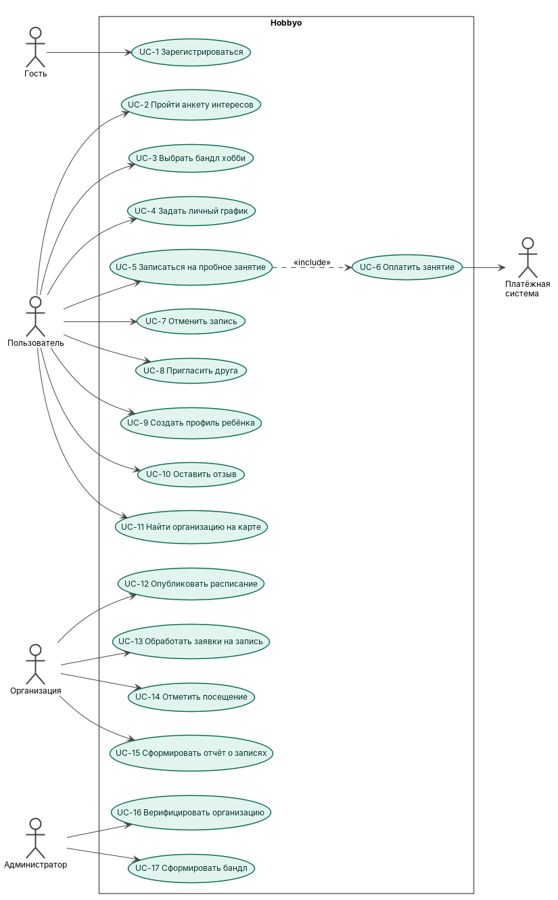

# 4. Варианты использования (Use Cases) — Hobbyo

Исходник диаграммы: [`diagrams/use_cases.puml`](../diagrams/use_cases.puml)

## 4.1. Реестр вариантов использования

Правило границ: пользователь заходит в систему, чтобы [название варианта использования], и выходит из системы. Название в формате «Глагол + Объект».

| ID | Название | Действующее лицо | Связанные ФТ | Описан ниже |
|---|---|---|---|---|
| UC-1 | Зарегистрироваться | Гость | ФТ-4, ФТ-83 | |
| UC-2 | Пройти анкету интересов | Пользователь | ФТ-10, ФТ-12 | да |
| UC-3 | Выбрать бандл хобби | Пользователь | ФТ-13 | |
| UC-4 | Задать личный график | Пользователь | ФТ-14 | |
| UC-5 | Записаться на пробное занятие | Пользователь | ФТ-15, ФТ-17, ФТ-18 | да |
| UC-6 | Оплатить занятие | Пользователь, Платёжная система | ФТ-18, ФТ-80 | |
| UC-7 | Отменить запись | Пользователь | ФТ-19, ФТ-81 | да |
| UC-8 | Пригласить друга | Пользователь | ФТ-22 | да |
| UC-9 | Создать профиль ребёнка | Пользователь | ФТ-23 | |
| UC-10 | Оставить отзыв | Пользователь | ФТ-25 | |
| UC-11 | Найти организацию на карте | Пользователь | ФТ-16, ФТ-82 | |
| UC-12 | Опубликовать расписание | Организация | ФТ-42, ФТ-43 | да |
| UC-13 | Обработать заявки на запись | Организация | ФТ-45, ФТ-46 | да |
| UC-14 | Отметить посещение | Организация | ФТ-47 | |
| UC-15 | Сформировать отчёт о записях | Организация | ФТ-50, ФТ-51 | |
| UC-16 | Верифицировать организацию | Администратор | ФТ-60 | да |
| UC-17 | Сформировать бандл | Администратор | ФТ-62 | |

## 4.2. Сценарии вариантов использования

### UC-2. Пройти анкету интересов

| | |
|---|---|
| **ID** | UC-2 |
| **Автор** | Команда FIP 13 |
| **Название** | Пройти анкету интересов |
| **Действующее лицо** | Пользователь |
| **Предусловия** | Пользователь зарегистрирован и вошёл в систему. Анкета ещё не заполнена |
| **Основной поток** | 1. Пользователь выбирает функцию «Пройти анкету» 2. Система выводит первый из 7 вопросов анкеты [Анкета интересов] с вариантами ответа 3. Пользователь выбирает ответ и выбирает функцию «Далее» 4. Система сохраняет ответ и выводит следующий вопрос 5. Шаги 3–4 повторяются до последнего вопроса 6. Пользователь отвечает на последний вопрос и выбирает функцию «Завершить» 7. Система убеждается, что даны ответы на все обязательные вопросы 8. Система рассчитывает процент совпадения для каждого хобби каталога 9. Система выводит список не более 20 рекомендованных хобби |
| **Расширения** | 3а. Пользователь не выбрал ответ   3а1. Система оповещает, что вопрос обязательный   3а2. Сценарий возвращается в п. 3  6а. Пользователь выбирает функцию «Пропустить анкету»   6а1. Система сохраняет данные ответы   6а2. Система выводит популярные хобби вместо персональных рекомендаций   6а3. Завершение сценария  8а. Нет хобби с процентом совпадения выше 0   8а1. Система выводит популярные хобби и сообщает, что анкету можно изменить  9а. Ошибка обращения к БД   9а1. Система оповещает пользователя об ошибке   9а2. Завершение сценария |

### UC-5. Записаться на пробное занятие

| | |
|---|---|
| **ID** | UC-5 |
| **Автор** | Команда FIP 13 |
| **Название** | Записаться на пробное занятие |
| **Действующее лицо** | Пользователь |
| **Предусловия** | Пользователь вошёл в систему. Задан личный график хотя бы с одним свободным окном |
| **Основной поток** | 1. Пользователь выбирает хобби и функцию «Подобрать время» 2. Система выводит слоты занятий этого хобби на ближайшие 14 дней, которые попадают в свободные окна пользователя и имеют свободные места 3. Пользователь выбирает слот 4. Система выводит форму [Запись]: организация, адрес, дата и время, цена, срок бесплатной отмены, на кого запись (сам пользователь или профиль ребёнка) 5. Пользователь выбирает, на кого запись, и выбирает функцию «Записаться» 6. Система убеждается, что в слоте есть свободное место и у пользователя нет другой записи на это время 7. Система выполняет вариант использования UC-6 «Оплатить занятие» 8. Система сохраняет запись со статусом «Ожидает подтверждения» 9. Система уведомляет организацию о новой записи 10. Система сообщает пользователю об успешной записи и предлагает добавить её в календарь |
| **Расширения** | 2а. Нет подходящих слотов   2а1. Система сообщает, что подходящих слотов нет, и выводит ближайшие слоты вне свободных окон   2а2. Пользователь выбирает слот вне окна или завершает сценарий  6а. Свободных мест не осталось   6а1. Система оповещает, что место занято   6а2. Сценарий возвращается в п. 2  6б. У пользователя уже есть запись на это время   6б1. Система оповещает о пересечении записей   6б2. Сценарий возвращается в п. 2  7а. Оплата не прошла   7а1. Система сообщает об ошибке оплаты, запись не создаётся   7а2. Сценарий возвращается в п. 4  8а. Ошибка обращения к БД   8а1. Система инициирует возврат оплаты   8а2. Система оповещает пользователя об ошибке   8а3. Завершение сценария |

### UC-7. Отменить запись

| | |
|---|---|
| **ID** | UC-7 |
| **Автор** | Команда FIP 13 |
| **Название** | Отменить запись |
| **Действующее лицо** | Пользователь |
| **Предусловия** | У пользователя есть предстоящая запись со статусом «Ожидает подтверждения» или «Подтверждена» |
| **Основной поток** | 1. Пользователь выбирает функцию «Мои записи» 2. Система выводит список предстоящих записей 3. Пользователь выбирает запись и функцию «Отменить» 4. Система убеждается, что до начала занятия осталось больше срока бесплатной отмены 5. Система запрашивает подтверждение отмены 6. Пользователь подтверждает отмену 7. Система меняет статус записи на «Отменена пользователем» и освобождает место в слоте 8. Система инициирует полный возврат оплаты через платёжную систему 9. Система уведомляет организацию об отмене 10. Система сообщает пользователю об успешной отмене |
| **Расширения** | 4а. Срок бесплатной отмены истёк   4а1. Система сообщает, что оплата не будет возвращена   4а2. Пользователь подтверждает отмену без возврата, сценарий продолжается с п. 7, п. 8 пропускается   4а3. Либо пользователь отказывается, завершение сценария  6а. Пользователь не подтверждает отмену   6а1. Завершение сценария, запись не меняется  8а. Платёжная система недоступна   8а1. Система ставит возврат в очередь на повтор каждые 30 минут   8а2. Система сообщает пользователю, что возврат будет выполнен позже |

### UC-8. Пригласить друга

| | |
|---|---|
| **ID** | UC-8 |
| **Автор** | Команда FIP 13 |
| **Название** | Пригласить друга |
| **Действующее лицо** | Пользователь |
| **Предусловия** | Пользователь вошёл в систему и открыл страницу занятия со свободными местами |
| **Основной поток** | 1. Пользователь выбирает слот и функцию «Пригласить друга» 2. Система формирует ссылку-приглашение на выбранный слот 3. Система выводит ссылку и варианты отправки: копировать, WhatsApp, Telegram 4. Пользователь выбирает вариант отправки 5. Система передаёт ссылку в выбранное приложение 6. Друг открывает ссылку 7. Система выводит другу страницу занятия с этим слотом и функцией «Записаться» |
| **Расширения** | 6а. Друг не зарегистрирован   6а1. Система предлагает зарегистрироваться (UC-1) и после регистрации возвращает на страницу слота  7а. В слоте не осталось мест   7а1. Система сообщает другу, что мест нет, и выводит другие слоты этого занятия |

### UC-12. Опубликовать расписание

| | |
|---|---|
| **ID** | UC-12 |
| **Автор** | Команда FIP 13 |
| **Название** | Опубликовать расписание |
| **Действующее лицо** | Организация |
| **Предусловия** | Профиль организации верифицирован. Создано хотя бы одно занятие |
| **Основной поток** | 1. Организация выбирает функцию «Расписание» 2. Система выводит календарь опубликованных слотов организации 3. Организация выбирает функцию «Добавить слот» 4. Система выводит форму [Слот]: занятие, дата, время начала, повторение (нет / еженедельно), количество недель (до 8) 5. Организация вносит данные и выбирает функцию «Опубликовать» 6. Система убеждается в полноте и корректности данных 7. Система убеждается, что новые слоты не пересекаются с уже опубликованными слотами того же занятия 8. Система сохраняет слоты и делает их доступными для записи 9. Система сообщает об успешной публикации и количестве созданных слотов |
| **Расширения** | 6а. Не заполнены обязательные поля   6а1. Система оповещает об ошибке и подсвечивает поля   6а2. Сценарий возвращается в п. 5  6б. Дата слота в прошлом   6б1. Система оповещает об ошибке   6б2. Сценарий возвращается в п. 5  7а. Найдено пересечение   7а1. Система выводит список пересекающихся слотов   7а2. Организация исправляет время (п. 5) или публикует только непересекающиеся слоты  8а. Ошибка обращения к БД   8а1. Система оповещает об ошибке   8а2. Завершение сценария |

### UC-13. Обработать заявки на запись

| | |
|---|---|
| **ID** | UC-13 |
| **Автор** | Команда FIP 13 |
| **Название** | Обработать заявки на запись |
| **Действующее лицо** | Организация |
| **Предусловия** | Есть записи со статусом «Ожидает подтверждения» |
| **Основной поток** | 1. Организация выбирает функцию «Заявки» 2. Система выводит список записей со статусом «Ожидает подтверждения», отсортированный по дате занятия 3. Организация выбирает запись 4. Система выводит данные записи: имя пользователя или ребёнка, занятие, дата и время, статус оплаты 5. Организация выбирает функцию «Подтвердить» 6. Система меняет статус записи на «Подтверждена» 7. Система отправляет пользователю уведомление о подтверждении 8. Сценарий повторяется с п. 3 для следующих заявок |
| **Расширения** | 5а. Организация выбирает функцию «Отклонить»   5а1. Система запрашивает причину отклонения   5а2. Организация вводит причину   5а3. Система меняет статус на «Отклонена», освобождает место и инициирует возврат оплаты   5а4. Система уведомляет пользователя с указанием причины  5б. Запись не обработана за 24 часа до начала занятия   5б1. Система автоматически подтверждает запись и уведомляет обе стороны |

### UC-16. Верифицировать организацию

| | |
|---|---|
| **ID** | UC-16 |
| **Автор** | Команда FIP 13 |
| **Название** | Верифицировать организацию |
| **Действующее лицо** | Администратор |
| **Предусловия** | Есть профили организаций со статусом «На проверке» |
| **Основной поток** | 1. Администратор выбирает функцию «Заявки организаций» 2. Система выводит список профилей со статусом «На проверке» 3. Администратор выбирает профиль 4. Система выводит данные профиля: название, категория, адрес на карте, телефон, Instagram, фото 5. Администратор проверяет данные и выбирает функцию «Одобрить» 6. Система меняет статус профиля на «Верифицирован» и делает организацию видимой в каталоге 7. Система уведомляет организацию по email |
| **Расширения** | 5а. Администратор выбирает функцию «Отклонить»   5а1. Система запрашивает причину   5а2. Администратор вводит причину   5а3. Система меняет статус на «Отклонён» и уведомляет организацию с причиной  6а. Адрес не найден в 2ГИС   6а1. Система предупреждает, что организация не будет показана на карте   6а2. Администратор подтверждает одобрение или отклоняет профиль (5а) |
